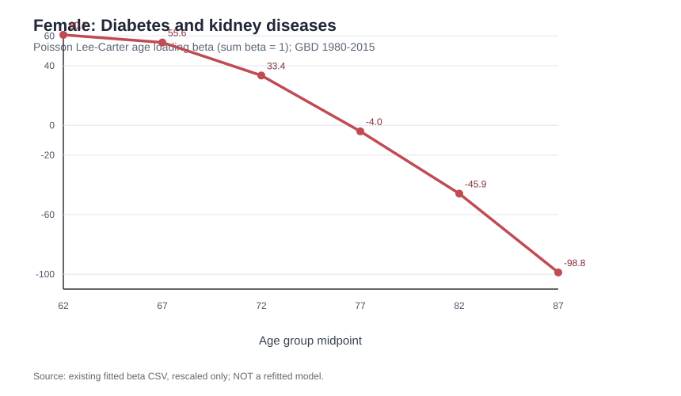

# Figure 3 | 实际结果与异常 beta 单独展示（2026-11-10）
    
本页记录的是**已有单因子 Poisson LC 拟合的后处理结果**，不是新的拟合实验；区别于原文 HCSO 数据。输入为同一次模型拟合输出的 alpha、beta、kappa（GBD 2023 Hungary、60–89 岁、1980–2015 训练、男女×九个 GBD Level 2 死因）。
    
## 我们实际展示的结果
    
**全部九类死因均保留。** Figure 3 的男性/女性 alpha、beta、kappa 六面板由 [plot_figure3_standard.R](plot_figure3_standard.R) 重现。其中仅在“女性 beta 主面板”中不叠加 Diabetes and kidney diseases 曲线，改为本页下方独立图；并非从模型、数据、kappa、alpha 或后续评价中剔除这类死因。
    

    
原始 six-panel PNG 在当前对话内已生成，GitHub 仅保存了完整重绘代码和可核验数值；仓库中**尚未上传六面板 PNG 本体**。运行脚本后会生成 `figure3_all_causes.png` 与 `figure3_female_diabetes_beta_companion.png`。
    
## 参数核验：18 个性别×死因模型
    
[下载诊断 CSV](figure3_constraint_diagnostics_2026-11-10.csv)（18 行、6 列）
    
| 指标 | 女性糖尿病与肾脏疾病 | 其他模型 |
|---|---:|---:|
| 原始拟合 beta 分量之和 | 0.0101163947 | 按组分别计算 |
| 正负抵消比例 `abs(sum(beta))/sum(abs(beta))` | **0.00334884** | 最小 0.869248（女性肿瘤）；其余接近 1 |
| `sum(beta)=1` 下 `max(abs(beta))` | **98.849445** | 最大 **0.329914** |
| 标准尺度 kappa 的标准差 | **0.00330988** | 各死因不同 |
    
其女性 beta 数值（年龄组中点 62, 67, 72, 77, 82, 87）：**60.73994、55.629396、33.436057、-4.049039、-45.906909、-98.849445**。
    
**解释**：年龄载荷呈正负对冲，导致总和接近零；按 LC 常用识别约束 `sum(beta)=1` 缩放时，beta 值膨胀、kappa 振幅相应缩小。这样的图若和其余八类共用 y 轴，会遮蔽其余曲线。因此额外作图是**可视化尺度决策**，不是对样本的剔除或医学因果判断。仅凭 beta 的量级不证明死亡率拟合失败，必须查 deviance/残差、收敛、随机起点、双因子模型与预测期表现。
    
### 重参数化不是重新拟合
    
若原解为 `alpha + beta*kappa`，在中心化及 beta 归一化后可保证每个年龄-年份单元的拟合对数死亡率不变（脚本中直接检查误差）。**更换识别尺度只改变参数数字，不提高或降低拟合精度**；而重新优化则可能改变最优解和拟合效果。
    
## 论文复现进度及证据边界
    
1. **Figure 3：** 已有18组真实拟合输出，完成标准尺度重绘、异常年龄载荷诊断；主图及独立图的重绘 R 程序已保存。
2. **Figure 4：** 必须重新拟合双因子 Poisson LC；不能把现有一因子 beta、kappa 转换成二因子估计。**尚无实测 Figure 4 参数或模型性能结论。**
3. **其余五种模型（实际加上一因子 Binomial LC，共六种待完成）：** 原文总计7种单人口模型，当前仅验证一因子 Poisson LC。这六种依次是 Binomial LC、二因子 Poisson LC、二因子 Binomial LC、CBD、二因子 reduced Plat、三因子 reduced Plat。不能写成已拟合。
4. **§4.2 DTW：** 仓库已含单因子 Poisson LC 的 DTW 代码，但未运行并核验聚类结果。分不同模型，双因子 Poisson/Binomial LC 采用第二时期因子，并针对异常 beta 对应时间因子进行敏感性分析。不能声称已得到七模型的聚类表。
    
完整 R 重绘脚本：[plot_figure3_standard.R](plot_figure3_standard.R)；现有单因子重拟合脚本：[run_4_1_poisson_lc.R](run_4_1_poisson_lc.R)；§4.2：[run_4_2_dtw.R](../4_2_clusters/run_4_2_dtw.R)。
