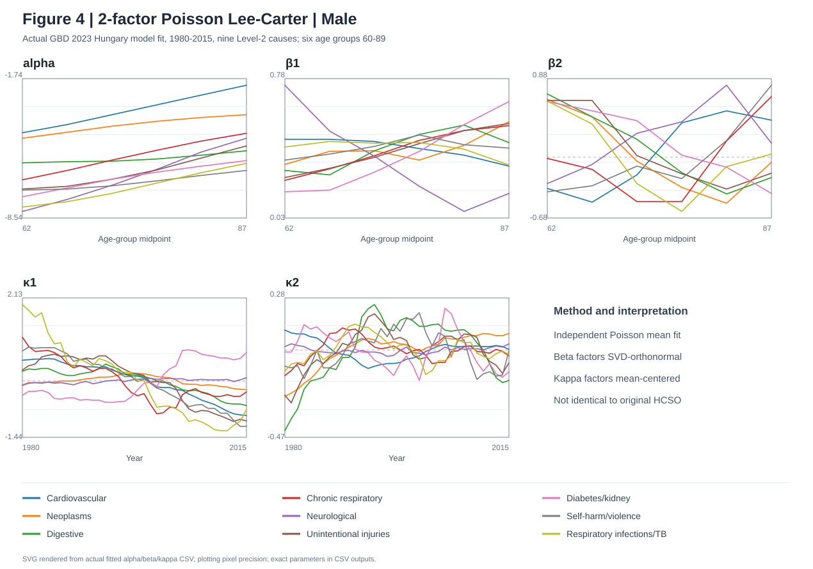
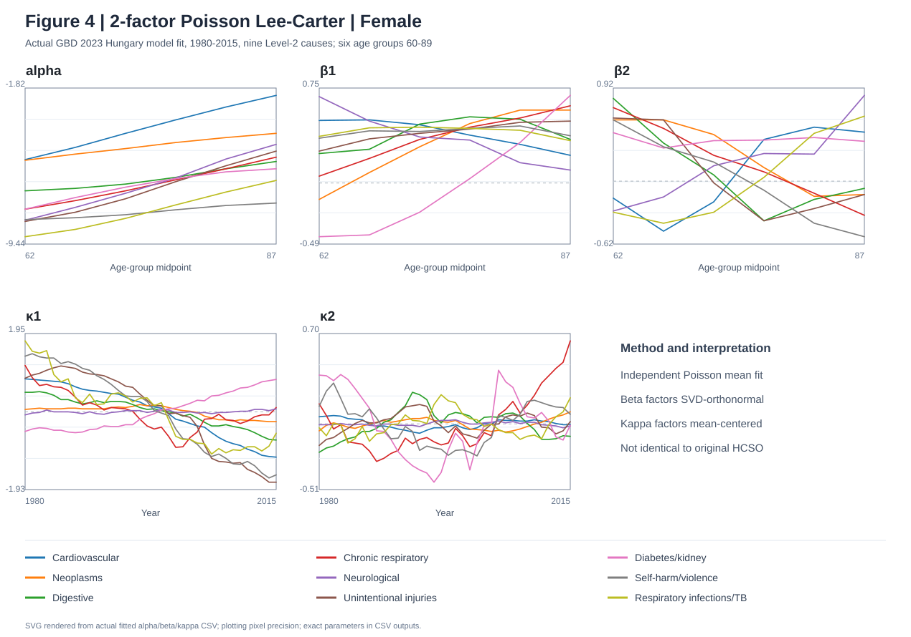

# §4.1 Figure 4 — GBD Hungary **实测双因子 Poisson Lee–Carter**（2026-11-10）

> **历史独立Python拟合记录。** 后来§4.1已经用纯R对全部126组单人口模型重新估计与验收。最新权威入口：[§4.1](README.md)／[纯R数值验收](../4_2_clusters/gbd_complete/R_MIGRATION_VALIDATION.md)。保留本文件用于追溯Figure4最初的真实数值图、RStudio报错与交叉验证。

> **本次是真实拟合，不是模拟测试。** 用户提供真实 `fitted_rates(1).csv`，包含 `deaths_gbd`（GBD Number）、`exposure_proxy`（GBD Population）和旧 `fitted_count`。我们通过 Python/SciPy 分别拟合 18 个双因子模型，旧一因子拟合值只用于比较、不用于新模型的估计。RStudio 原脚本先前能拟合但保存出现 `outdir` 未定义问题，现已修复，见 [最新版 R 代码](run_4_1_poisson_lc_2factor.R)。

## 0. 真实参数结果图（九个死因均保留）

**男性，原文 Figure 4 的五类参数布局（alpha、beta1、beta2、kappa1、kappa2）**：

**女性，作为本项目补充**：

> 两幅 SVG 由真实拟合后的 alpha、beta、kappa CSV 数值生成（显示精度 8 位绘图刻度，供展示），本对话另存有更高精度 PNG 及全部参数 CSV；**并非原文 HCSO 的数值复制**。

## 1. 数据来源与可追溯性

- 上传文件：`fitted_rates(1).csv`，SHA256 `d42bee01e8f3dcb1897303de060120eccf4228a326cdb45c4f85c7854c8bfa68`
- 3888 行 = 9 GBD Level-2 causes × 男/女 × 6 个年龄组（60–89）× 36 年（1980–2015）。
- 因为 GBD Number 是非整数的模型估计量，**Poisson 均值假设为拟似然式估计**，不等于真实登记死亡人数的严格计数似然。
- `D[x,t]` 和 `E[x,t]` 来自用户 CSV 的 `deaths_gbd` / `exposure_proxy`，不是以前一因子的 `fitted_count` 作为观测死亡。
- 本次拟合器：Python SciPy `minimize(method='L-BFGS-B')`，解析梯度，SVD 初始值及确定双因子的两个 anchor 年龄；每组2个起点。程序从该 CSV 独立重新估计二因子参数，再对 `B K^T` 进行SVD规范化（beta 正交、kappa 均值零、奇异值排序、符号固定），重建原预测面。
- GitHub 的 **R 实现** 使用 `optim(BFGS)`、3 起点、相同形式的年龄锚定与 SVD 规范化；尚未在当前环境安装 R 复验，**不可直接断言两套优化器的逐点数值完全相同**。用户需要从最新版 R 脚本开头运行一次以交叉核验。

## 2. 18 组模型训练期拟合比较：真实数据

[**下载18组实测摘要数据**](figure4_actual_summary_2026-11-10.csv)

- 单因子训练期 Poisson deviance 总计 **4268.3543**；双因子 **875.9410**。
- 18/18 组二因子训练 deviance 降低；9/18 组伪 AIC 更低；**只有 6/18 组伪 BIC 更低**。
- 两因子相对单因子增加 **38 个可识别参数**（p1=46，p2=84，216个年龄×年份单元）。复杂度惩罚之后不是所有死因都值得使用双因子。
- 其中男性：心血管减少475.58、肿瘤减少650.74、消化减少468.81；女性：糖尿病与肾脏疾病减少550.73、慢性呼吸减少386.41。
- 女性糖尿病与肾脏疾病：单因子 deviance **568.8344**，二因子 **18.1007**，改善 **550.7337**；伪AIC差 **−474.73**，伪BIC差 **−346.47**，第二奇异值比第一约 **0.5702**。这支持**双因子改善训练拟合**，不能推断样本外预测准确率已经改善。
- 全部18组SciPy优化器报告成功；计算中最大归一化梯度 **8.14e−7**；SVD重识别前后拟合对数率最大误差 **1.89e−15**。这些是数值一致性证据而非模型设定检验。

## 3. 原文对照：为什么画出的图不一样？

- 原文 Figure 4 位于第13页，**三张上排＋两张下排**，展示的五类参数都是曲线，**不是**用户截图中的比较柱状图。
- 旧版 R 程序在 Plots **最后展示比较柱状图**，所以截图只看到 bar chart；往前翻 Plots 可见男性/女性 Figure 4。
- 原文 HCSO/ICD 章节、1970–2021、60+，本项目 GBD Level2 / 1980–2015 / 60–89、仅6年龄组，参数曲线的点数和形状不可能完全一致。
- SVD正交识别的 `beta,kappa` 尺度不同于论文中使用的其他约束，因此**数值刻度不可直接比较**，但 `alpha + sum beta*kappa` 和拟合的 log-rate 有明确含义。

## 4. RStudio 保存错误已修复

用户截图报错 `找不到对象 outdir`：旧程序通过 `readline()` 收集是否保存的回应，未成功创建 `outdir` 后继续执行写入；另一个混淆是最后一张图为训练期比较图。

修正版 [R 脚本](run_4_1_poisson_lc_2factor.R) 从头 Source：选择 `fitted_rates.csv`，程序**自动保存**为源 CSV 同目录中带时间戳的 `Figure4_Poisson_LC_2factor_YYYYMMDD_HHMMSS`，**最后默认显示男性五面板参数图**。不必输入 y。只运行末尾几行会因为上游变量缺失再次报错。

## 5. 后续验证：比训练期拟合更重要

- 比较 2016–2019 **样本外预测误差**，需要预测因子的时间序列外推；本次仅做了1980—2015拟合，不能称为预测提升。
- 检查按年龄×年份的残差、不同优化器与初始值稳定性、第二奇异值大小和时间因子的**旋转、符号与排序可识别性**。
- 再到 §4.2 DTW：论文对于二因子 Poisson/Binomial LC 使用第二时间因子；但本项目 SVD 旋转必须先确认对死因间DTW距离的稳定性，因为DTW分组**不具有因子旋转不变性**。

**论文证据**：[Varga (2025)](https://doi.org/10.1080/03461238.2025.2480846) Figure 4 与 §4.2。
